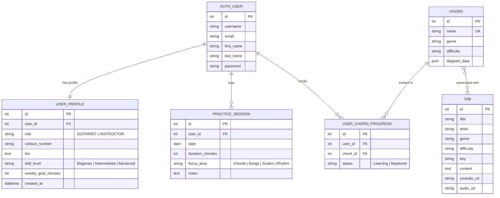

# PROJECT DELIVERABLE 2 (PD2) REPORT
## Phase 1: System Foundation & Account Feature Implementation

**Project Title:** FretMate: Web-Based Practice & Skill-Analytics Platform for Guitarists  
**Author:** Brixel Jay Dacumos  
**Degree Program:** Bachelor of Science in Information Technology (BSIT)  
**Course:** Information Management 2 (IM2) – Section G7  
**Institution:** Cebu Institute of Technology - University (CIT-U)  
**Date of Submission:** November 18, 2026  
**Repository:** [https://github.com/biji929/FretMate-Dacumos-BrixelJay-G7](https://github.com/biji929/FretMate-Dacumos-BrixelJay-G7)  

---

## 1. Executive Summary & Problem Background

Self-directed musicians and guitar students typically rely on multiple fragmented tools: standalone digital tuners, metronome applications, chord chart sheets, tablature notebooks, and practice logs. This fragmentation causes inconsistent habit tracking, lack of visibility into skill progression, and missed practice milestones.

**FretMate** addresses this problem by delivering an integrated, web-based platform that combines real-time guitar practice tools with rich skill analytics. In this initial phase (**Phase 1 / PD2**), the foundational infrastructure and the **Account Feature** have been constructed. The account system provides registration, authentication, role-based dashboards, and personal profile management upon which all future modules depend.

---

## 2. Technology Stack & Environment

| Component | Selected Technology | Architectural Justification |
| :--- | :--- | :--- |
| **Backend Framework** | Python 3.12+ / Django 6.x | Robust ORM, built-in cryptographically secure authentication, session management, and CSRF protection. |
| **Frontend & UI** | Django Templates + Tailwind CSS | Responsive, mobile-friendly design with Dark and Light mode support. Server-rendered for fast initial load. |
| **Data Visualizations** | Chart.js 4.x | Lightweight, interactive canvas charts for 7-day practice trends and focus-area time distribution. |
| **Audio Processing** | Web Audio API (Client-side JS) | Zero-latency browser-native digital signal processing (DSP) for guitar tuning and metronome scheduling. |
| **Database** | PostgreSQL / Supabase (`psycopg3`, `dj-database-url`) | Relational database with transactional pooling support; local SQLite fallback for isolated development. |
| **Static Assets** | WhiteNoise | Production-grade static asset compression and caching directly from Django WSGI/ASGI. |

---

## 3. Account Feature Implementation Details

The Account Feature was built to fulfill all academic specifications with rigorous validation, cryptographic security, and role-based access control.

### 3.1 Account Registration
- **User Inputs:** First Name, Last Name, Username, Email Address, Account Role, Password, and Password Confirmation.
- **Input Validation Rules:**
  - `email`: Formatted as a valid RFC-compliant email; must be strictly unique across the database.
  - `username`: Alphanumeric, unique check against existing accounts.
  - `password`: Enforces minimum length, complexity, non-similarity to personal details, and numeric-only rejection.
  - `password confirmation`: Must match `password` identically.
- **Security:** Passwords are never stored in plain text. They are hashed using Django's PBKDF2 algorithm with SHA-256 iterations.
- **User Experience:** Instant error reporting on invalid fields and a success notification upon creation.

### 3.2 Authentication & Session Management
- **Login:** Users log in using username and password. Invalid credentials yield clear user alerts without leaking account existence.
- **Session Termination (Logout):** Implemented via POST requests to prevent malicious CSRF logouts, flushing session state and cookies.
- **Route Protection:** All authenticated routes (`/dashboard/`, `/profile/`, `/logger/`, `/library/`, `/songs/`, `/tools/`) are guarded with the `@login_required` decorator, redirecting unauthorized guests to the login page.

### 3.3 Role-Based User Dashboards & Access Control (RBAC)
FretMate defines two distinct user roles tailored to musical instruction:
1. **Guitarist (Student / Member):**
   - Focuses on individual progress: total practice minutes, daily streak counter, chords mastered tracker, and weekly goal progress bar.
   - Dynamic Chart.js 7-day practice trend line chart and focus distribution doughnut chart (Chords, Songs, Scales, Rhythm).
   - Fast access to log sessions, browse chords, and use Web Audio tuner/metronome.
2. **Instructor (Teacher / Admin):**
   - Focuses on curriculum oversight: view total registered student count, platform practice hours, and catalog sizes.
   - Enrolled student roster displaying student names, emails, skill tiers, and weekly targets.
   - **Student Drill-Down:** Dedicated portal (`/instructor/student/<id>/`) to view individual student practice logs, chord mastery, and notes.
- **URL Protection Mechanism:**
  - Custom `@role_required` decorator intercepts every request.
  - If a user attempts to manually type the URL of a portal outside their role (e.g., a Guitarist typing `/dashboard/instructor/`), access is blocked, a warning message is flashed, and the user is redirected back to their authorized dashboard.

### 3.4 User Profile Management
- **Profile View:** Dedicated `/profile/` route displaying user avatar initial, full name, username, role badge, email, contact number, join date, bio, skill level, and weekly goal.
- **Profile Edit:** Form enables updating First Name, Last Name, Email, Contact Number, Bio, Skill Level, and Weekly Goal.
- **Data Isolation:** Strictly enforces `request.user` references so users can only view and mutate their own profile data.

---

## 4. Logical Data Model & Entity Specifications

### 4.1 Entity Relationship Diagram (ERD)



### 4.2 Data Dictionary

| Table Name | Column | Data Type | Constraints | Description |
| :--- | :--- | :--- | :--- | :--- |
| `auth_user` | `id` | Integer | PK, Auto Increment | Primary key for user identity. |
| `auth_user` | `username` | Varchar(150) | Unique, Not Null | Unique username for credentials. |
| `auth_user` | `email` | Varchar(254) | Not Null, Unique check | Valid email for communication. |
| `dashboard_userprofile` | `user_id` | Integer | FK (`auth_user.id`), Unique | 1:1 relationship to Django User. |
| `dashboard_userprofile` | `role` | Varchar(20) | Choices: `GUITARIST`, `INSTRUCTOR` | Role for RBAC permissions. |
| `dashboard_userprofile` | `contact_number` | Varchar(25) | Blank, Nullable | Contact number for student profile. |
| `dashboard_userprofile` | `bio` | Text(500) | Blank, Nullable | Short musician biography. |
| `dashboard_userprofile` | `skill_level` | Varchar(20) | Default: `Beginner` | Self-reported guitar tier. |
| `dashboard_userprofile` | `weekly_goal_minutes`| Integer | Check: 10–3000, Default: 120 | Weekly practice target in minutes. |
| `dashboard_practicesession` | `duration_minutes` | Integer | Check: 1–600 | Duration of practice session. |
| `dashboard_practicesession` | `focus_area` | Varchar(20) | Choices: Chords, Songs, Scales, Rhythm | Focus category. |
| `dashboard_userchordprogress` | `status` | Varchar(20) | Choices: Learning, Mastered | Mastery tracking status. |

---

## 5. Verification & Automated Test Suite

A complete automated unit testing suite was developed in `dashboard/tests.py`. All **14 tests execute successfully with 0 errors**:

```text
Found 14 test(s).
Creating test database for alias 'default'...
..............
----------------------------------------------------------------------
Ran 14 tests in 8.720s

OK
Destroying test database for alias 'default'...
```

### 5.1 Test Cases Summary Table

| Test Case Name | Objective | Expected Result | Status |
| :--- | :--- | :--- | :---: |
| `test_auth_protection` | Check anonymous access to `/dashboard/` | HTTP 302 Redirect to `/login/` | **PASSED** |
| `test_logger_ajax` | Post valid practice log via AJAX | HTTP 201 Created & DB persisted | **PASSED** |
| `test_data_isolation` | Ensure practice records are user-scoped | User A cannot query User B records | **PASSED** |
| `test_songs_view` | Test Song Library page load | HTTP 200 OK | **PASSED** |
| `test_add_song_post` | Submit new song tablature | HTTP 302 Redirect & record saved | **PASSED** |
| `test_registration_with_email_and_role` | Register with valid email and role | User created with role & email | **PASSED** |
| `test_registration_duplicate_email_rejected` | Register with existing email | Form invalid with duplicate error | **PASSED** |
| `test_role_based_dashboard_dispatch` | Test login dispatch for both roles | Guitarist -> `/dashboard/guitarist/`, Instructor -> `/dashboard/instructor/` | **PASSED** |
| `test_role_url_protection_blocks_guitarist` | Guitarist types instructor URL | Blocked, redirected to guitarist view | **PASSED** |
| `test_user_profile_view_and_edit` | View and edit own profile info | HTTP 200 on GET, HTTP 302 on POST, DB updated | **PASSED** |
| `test_api_chord_progress_learning_and_mastered` | AJAX toggle chord mastery | HTTP 200 & record created/updated | **PASSED** |
| `test_api_chord_progress_reset` | Toggle off chord mastery | HTTP 200 & record deleted from DB | **PASSED** |
| `test_instructor_student_detail_view` | Instructor inspects student logs | HTTP 200 with student progress context | **PASSED** |
| `test_instructor_student_detail_blocked_for_guitarist` | Guitarist accesses student detail URL | Access denied, redirected safely | **PASSED** |

---

## 6. Repository & Branching Compliance

- **GitHub Repository:** `https://github.com/biji929/FretMate-Dacumos-BrixelJay-G7`
- **Visibility:** Public (confirmed via Private/Incognito browser session)
- **Branch Strategy:**
  - `develop`: Staging and active feature development branch.
  - `main`: Production release branch. All verified features and the PD2 report are merged from `develop` into `main`.
- **Secret Hygiene:** Database credentials, secret keys, and local SQLite database binaries are strictly excluded via `.gitignore`.

---

*Report prepared by Brixel Jay Dacumos for IM2 Evaluation, Cebu Institute of Technology - University.*
